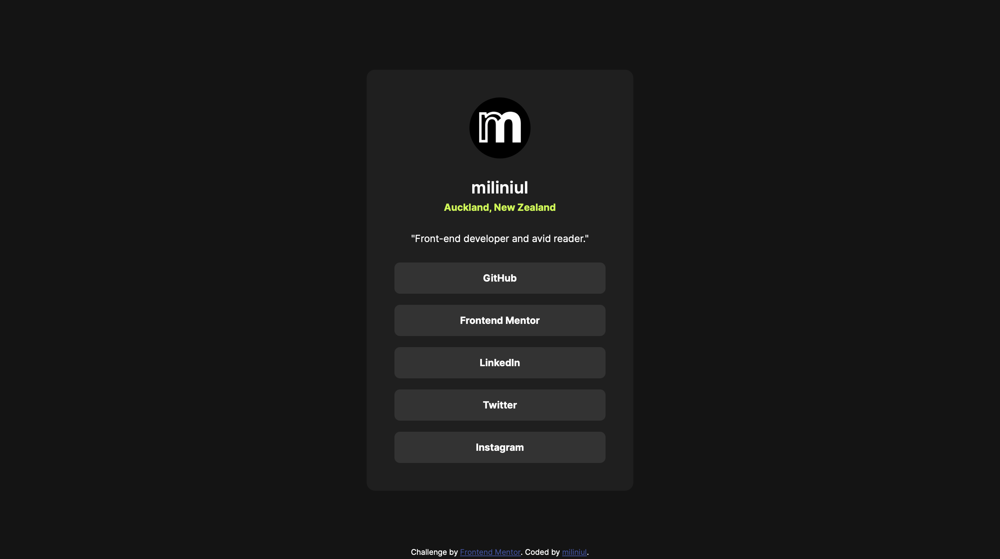

# Frontend Mentor - Social links profile solution

This is a solution to the [Social links profile challenge on Frontend Mentor](https://www.frontendmentor.io/challenges/social-links-profile-UG32l9m6dQ). Frontend Mentor challenges help you improve your coding skills by building realistic projects. 

## Table of contents

- [Overview](#overview)
  - [The challenge](#the-challenge)
  - [Screenshot](#screenshot)
  - [Links](#links)
- [My process](#my-process)
  - [Built with](#built-with)
  - [What I learned](#what-i-learned)
  - [Continued development](#continued-development)
  - [Useful resources](#useful-resources)
  - [AI Collaboration](#ai-collaboration)
- [Author](#author)

## Overview

### The challenge

The links in the card are interactive. Their text changes from white to dark gray, and their background changes from gray to green on hover or when focused using keyboard navigation, providing visual feedback for both mouse and keyboard users.

### Screenshot

### Links

- Solution URL: [Social links profile](https://miliniul.github.io/social-links-profile/)

## My process

### Built with

- Semantic HTML5 markup
- CSS custom properties
- CSS Grid
- Mobile-first workflow

### What I learned

I practiced using CSS Grid to organize the page layout. With `grid-template-rows: 1fr auto 1fr`, I placed the profile card in the middle row and the footer at the bottom of the page. This helped me separate the overall page layout from the layout inside the card.

I also learned how to style links for both mouse and keyboard users. By combining `:hover` and `:focus-visible`, I made the links change their text and background colors when hovered over or focused using keyboard navigation.

Finally, I used `transition: background-color 1s` to make the background color change smoothly instead of instantly. This gave me practice applying a transition to a specific CSS property.

### Continued development

In future projects, I want to deepen my understanding of HTML and CSS, with a focus on semantic HTML, responsive design, and building layouts with Grid and Flexbox. I also want to become more confident in managing spacing and choosing the right layout approach for each task.

My next step is to start learning JavaScript so I can add interactivity to my pages. I plan to begin with the fundamentals, then practice working with the DOM and handling user events.

I also want to improve accessibility and write cleaner, more organized code as I build new projects.

### Useful resources

- [Doka](https://doka.guide/) — A community-driven resource in Russian with clear explanations and practical examples of HTML, CSS, and JavaScript. Useful for understanding layout techniques and reviewing the basics.
- [MDN Web Docs](https://developer.mozilla.org/en-US/) — Comprehensive documentation and guides for web technologies. A helpful reference for checking syntax, exploring CSS properties, and learning JavaScript.

### AI Collaboration

I used Perplexity to find learning resources and explore HTML and CSS concepts while working on this project. It helped me understand Flexbox, how to add custom fonts, and how to manage spacing between elements.

I used it as a learning aid, testing the suggestions in my project to better understand how they worked.

## Author

- Frontend Mentor - [@miliniul](https://www.frontendmentor.io/profile/miliniul)
